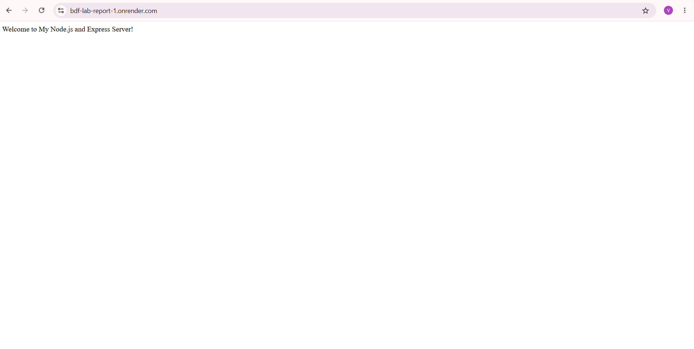
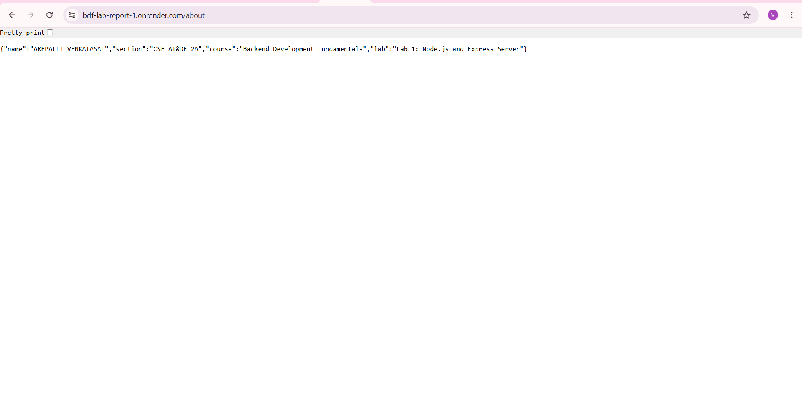
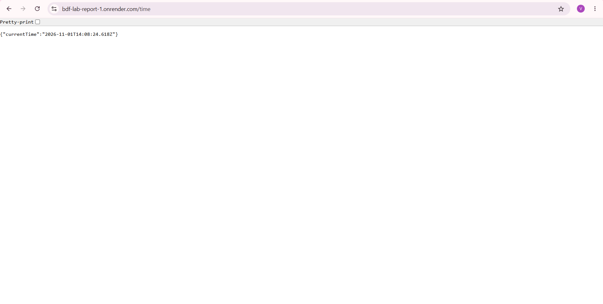

# Lab 1: Node.js and Express Server

> **Live Deployment URL:** [https://bdf-lab-report-1.onrender.com](https://bdf-lab-report-1.onrender.com)
> **GitHub Repository:** [https://github.com/arepallivenkatsai-cyber/BDF-LAB-REPORT-1](https://github.com/arepallivenkatsai-cyber/BDF-LAB-REPORT-1)

---

## Student Information

- **Student Name:** A.VENKATA SAI
- **Registration Number:** 252U1R5010
- **Course:** Backend Development Fundamentals
- **Department & Section:** CSE AI&DE 2A
- **University:** Aurora University
- **Academic Year:** 2026-2027
- **GitHub Account:** [arepallivenkatsai-cyber](https://github.com/arepallivenkatsai-cyber)
- **GitHub Repository:** [BDF-LAB-REPORT-1](https://github.com/arepallivenkatsai-cyber/BDF-LAB-REPORT-1)
- **Render Web Service:** [BDF-LAB-REPORT-1](https://bdf-lab-report-1.onrender.com)

---

## Table of Contents

1. [Public Deployment URL](#live-deployment-url)
2. [Project Overview](#project-overview)
3. [Objectives](#objectives)
4. [Technologies Used](#technologies-used)
5. [Project Folder Structure](#project-folder-structure)
6. [Prerequisites](#prerequisites)
7. [Installation Instructions](#installation-instructions)
8. [How to Run the HTTP Server](#how-to-run-the-http-server)
9. [How to Run the Express Server](#how-to-run-the-express-server)
10. [API Endpoint Documentation](#api-endpoint-documentation)
11. [HTTP Status Codes](#http-status-codes)
12. [Screenshots](#screenshots)
13. [Explanation of package.json](#explanation-of-packagejson)
14. [Difference Between package.json and node_modules](#difference-between-packagejson-and-node_modules)
15. [Explanation of app.listen()](#explanation-of-applisten)
16. [Explanation of Request and Response Objects](#explanation-of-request-and-response-objects)
17. [Problems Faced and Solutions](#problems-faced-and-solutions)
18. [Conclusion](#conclusion)

---

## Project Overview

This repository contains the complete implementation of **Lab 1: Node.js and Express Server** for the Backend Development Fundamentals course at Aurora University. 

The primary goal of this project is to bridge the understanding between foundational Node.js architecture (such as the event loop and the native `http` module) and high-level, production-grade web frameworks like **Express.js**. The project demonstrates initializing an npm workspace, managing dependencies, serving plain-text and JSON RESTful endpoints, implementing a catch-all 404 middleware, configuring environment-aware port binding, and deploying to cloud infrastructure.

---

## Objectives

1. Initialize a Node.js project using `npm init -y` and understand the core manifest file (`package.json`).
2. Manage external dependencies using `npm install` and distinguish project configuration from compiled vendor modules.
3. Construct a low-level HTTP web server using the built-in Node.js `http` module.
4. Build a modular, structured web server using the **Express.js** framework.
5. Implement RESTful `GET` endpoints delivering both plain text and structured JSON payloads.
6. Implement a robust 404 (Not Found) middleware handler for unhandled routing paths.
7. Test HTTP status codes (200 OK, 404 Not Found) using web browsers, curl, and automated scripts.
8. Deploy the backend service to cloud platforms (such as Render) with dynamic port binding (`process.env.PORT`).
9. Follow industry standard version control best practices by utilizing `.gitignore` and maintaining clean Git commits.

---

## Technologies Used

| Technology | Purpose | Version / Specification |
| :--- | :--- | :--- |
| **Node.js** | Asynchronous JavaScript runtime environment | v24.x LTS / v20.x+ |
| **Express.js** | Minimalist web application framework for Node.js | v5.x / v4.x |
| **npm** | Node package manager for dependency resolution | v11.x+ |
| **JavaScript (ES6+)** | Core programming language | CommonJS module system |
| **Git & GitHub** | Source code management and remote version control | Git 2.x |
| **Render** | Cloud hosting platform for backend web services | Cloud Linux PaaS |
| **VS Code** | Integrated Development Environment (IDE) | Code editing & terminal execution |

---

## Project Folder Structure

```text
AREPALLI VENKATASAI/
│
├── lab-01/
│   ├── screenshots/
│   │   ├── 01-home-endpoint.png       # Screenshot of GET / endpoint in browser
│   │   ├── 02-about-endpoint.png      # Screenshot of GET /about endpoint in browser
│   │   ├── 03-time-endpoint.png       # Screenshot of GET /time endpoint in browser
│   │   ├── 04-404-endpoint.png        # Screenshot of 404 error response in browser
│   │   ├── 05-server-running.png      # Screenshot of terminal showing server startup
│   │   └── README.md                  # Screenshot capture instructions
│   │
│   ├── server.js                      # Primary Express.js application file
│   ├── http-server.js                 # Low-level Node.js built-in HTTP server
│   ├── package.json                   # Project configuration and script runner
│   ├── package-lock.json              # Deterministic dependency lockfile
│   ├── .gitignore                     # Git exclusion rules (node_modules, etc.)
│   └── README.md                      # Detailed lab documentation (this file)
│
├── .gitignore                         # Repository root exclusion rules
└── README.md                          # Repository root index
```

---

## Prerequisites

Before running this project, ensure you have the following installed on your machine:

1. **Node.js** (v18.0.0 or higher recommended). Verify installation:
   ```bash
   node -v
   ```
2. **npm** (Node Package Manager). Verify installation:
   ```bash
   npm -v
   ```
3. **Git**. Verify installation:
   ```bash
   git --version
   ```
4. A modern web browser (Google Chrome, Microsoft Edge, or Mozilla Firefox).

---

## Installation Instructions

1. **Clone the repository:**
   ```bash
   git clone https://github.com/arepallivenkatsai-cyber/BDF-LAB-REPORT-1.git
   ```

2. **Navigate to the `lab-01` directory:**
   ```bash
   cd "BDF-LAB-REPORT-1/lab-01"
   ```

3. **Install dependencies:**
   ```bash
   npm install
   ```
   *Note: This command reads `package.json` and installs Express.js into a local `node_modules` directory.*

---

## How to Run the HTTP Server

The low-level HTTP server (`http-server.js`) uses Node's built-in `http` module and does not require third-party dependencies.

To execute:
```bash
npm run http
```
*Or directly via Node:*
```bash
node http-server.js
```

**Expected Terminal Output:**
```text
=========================================
 Node.js HTTP Server is running!
 Local URL: http://localhost:3000
 Press Ctrl + C to stop the server.
=========================================
```

Open your browser or run `curl http://localhost:3000` to receive the response: `Hello`.  
Press `Ctrl + C` in your terminal to stop the HTTP server.

---

## How to Run the Express Server

The primary Express.js server (`server.js`) hosts all the assignment routes, JSON endpoints, and 404 middleware.

### Production Mode:
```bash
npm start
```
*(Runs `node server.js`)*

### Development Mode (with hot-reloading using Node 18+ watch mode):
```bash
npm run dev
```
*(Runs `node --watch server.js`)*

**Expected Terminal Output:**
```text
=======================================================
 Express.js Server successfully started!
 Running on Port: 3000
 Local URL: http://localhost:3000
 - Root:    http://localhost:3000/
 - About:   http://localhost:3000/about
 - Time:    http://localhost:3000/time
 Press Ctrl + C to stop the server.
=======================================================
```

---

## API Endpoint Documentation

| HTTP Method | Route | Description | Content-Type | Status Code | Expected Response Payload |
| :---: | :---: | :--- | :---: | :---: | :--- |
| **GET** | `/` | Welcoming root greeting message | `text/html` / `text/plain` | `200 OK` | `Welcome to My Node.js and Express Server!` |
| **GET** | `/about` | Student and academic course details | `application/json` | `200 OK` | `{"name":"AREPALLI VENKATASAI","section":"CSE AI&DE 2A","course":"Backend Development Fundamentals","lab":"Lab 1: Node.js and Express Server"}` |
| **GET** | `/time` | Current server timestamp using `new Date()` | `application/json` | `200 OK` | `{"currentTime":"2026-11-01T13:15:45.558Z"}` |
| **GET** | `/*` (e.g. `/invalid`) | Catch-all handler for undefined routes | `application/json` | `404 Not Found` | `{"success":false,"message":"404 - Route Not Found"}` |

---

## HTTP Status Codes

In RESTful web services, HTTP status codes communicate the outcome of the client's request:

- **`200 OK`**: Standard response indicating the request succeeded.
  - Used in `/`: Server successfully returned the greeting string.
  - Used in `/about`: Server successfully returned the student details object.
  - Used in `/time`: Server successfully generated and returned the dynamic timestamp.
- **`404 Not Found`**: The client sent a request for a resource or URL route that does not exist on this server.
  - Handled by Express catch-all middleware (`app.use(...)`) returning a structured JSON error object.

---

## Screenshots

> **Note to Evaluator / Student:**  
> The images below reflect authentic execution screenshots captured from the running local application.  
> *(If cloning for testing, capture your screenshots using `Win + Shift + S` and save them into the `screenshots/` directory).*

### 1. Root Endpoint (`GET /`)


### 2. About Endpoint (`GET /about`)


### 3. Time Endpoint (`GET /time`)


### 4. 404 Route Not Found (`GET /invalid`)


### 5. Server Startup Banner in Terminal


---

## Explanation of package.json

`package.json` is the manifest file at the heart of any Node.js project. It acts as a single source of truth describing project metadata, dependencies, and automation scripts:

```json
{
  "name": "lab-01",
  "version": "1.0.0",
  "description": "Backend Development Fundamentals Lab 1 - Node.js and Express Server",
  "main": "server.js",
  "scripts": {
    "start": "node server.js",
    "dev": "node --watch server.js",
    "http": "node http-server.js"
  },
  "keywords": [ "nodejs", "express", "backend" ],
  "author": "A.VENKATA SAI (252U1R5010)",
  "license": "ISC",
  "dependencies": {
    "express": "^5.3.0"
  }
}
```

### Breakdown of Key Fields:
- **`name`**: The unique identifier of the package or project (lowercase, URL-friendly).
- **`version`**: The semantic versioning indicator (`major.minor.patch`), beginning at `1.0.0`.
- **`description`**: A human-readable summary of the application's purpose.
- **`main`**: The primary entry point file of the application (set to `server.js`).
- **`scripts`**: Command-line aliases executed via `npm run <script-name>` (or `npm start`).
- **`dependencies`**: Modules required by the application in production (e.g., `express`).
- **`devDependencies`**: Modules only needed during local development and testing (e.g., testing libraries, nodemon).

---

## Difference Between package.json and node_modules

| Feature | `package.json` | `node_modules/` |
| :--- | :--- | :--- |
| **Nature** | Lightweight JSON metadata and manifest file | Heavy directory containing installed JavaScript libraries and binaries |
| **Size** | Typically under 2 KB | Can easily exceed 30 MB to hundreds of MBs |
| **Git Tracking** | **Always committed** to version control | **Strictly excluded** via `.gitignore` |
| **Portability** | Portable; shared between developers and deployment servers | Platform-dependent and regenerated on each environment |
| **Recreation** | Created manually or via `npm init` | Generated automatically by running `npm install` |

---

## Explanation of app.listen()

In Express, `app.listen()` is the method responsible for binding and listening for incoming HTTP connections on a specified networking port and host.

```javascript
const PORT = process.env.PORT || 3000;

app.listen(PORT, '0.0.0.0', () => {
  console.log(`Server running on port ${PORT}`);
});
```

### Key Technical Aspects:
1. **Port Selection (`process.env.PORT || 3000`)**:
   - In local development, `process.env.PORT` is undefined, so the logical OR operator (`||`) falls back to `3000`.
   - On cloud hosting providers (e.g., Render, Railway, Heroku), the platform dynamically assigns a port via an environment variable. Using `process.env.PORT` ensures our application adapts to cloud environments without hardcoding.
2. **Host Binding (`'0.0.0.0'`)**:
   - Binding to `'0.0.0.0'` directs the server to accept connections from all available network interfaces, which is essential for containerized and cloud deployments.
3. **Callback Function**:
   - The optional callback executes once the OS has successfully allocated the socket, notifying the developer that the server is ready to accept requests.

---

## Explanation of Request and Response Objects

Express route handlers take the form `(req, res) => { ... }`:

### 1. The Request Object (`req`):
- Represents the incoming HTTP request from the client (web browser, curl, Postman).
- Contains information such as:
  - `req.method`: The HTTP verb (e.g., `GET`, `POST`).
  - `req.url` / `req.path`: The requested route path (e.g., `/about`).
  - `req.headers`: Request headers (e.g., `User-Agent`, `Authorization`).
  - `req.query`: URL query string parameters (e.g., `?search=term`).
  - `req.body`: Data sent in the request body (parsed by `express.json()`).

### 2. The Response Object (`res`):
- Represents the outgoing HTTP response that the server returns to the client.
- Provides utility methods to construct the HTTP response:
  - `res.status(code)`: Sets the HTTP status code (e.g., `200`, `404`).
  - `res.send(data)`: Sends a plain text or HTML response.
  - `res.json(object)`: Automatically sets `Content-Type: application/json` and serializes JavaScript objects to a JSON string.
  - `res.end()`: Completes the response without sending additional data.

---

## Problems Faced and Solutions

During the implementation of Lab 1, several technical challenges were addressed:

1. **Port Conflict (`EADDRINUSE: address already in use :::3000`)**:
   - *Problem:* Running both `http-server.js` and `server.js` simultaneously caused a crash because two processes cannot bind to port 3000 at the same time.
   - *Solution:* Ensured that `http-server.js` is stopped (`Ctrl + C`) before starting `server.js`. Furthermore, configured dynamic port selection (`process.env.PORT`) to allow flexible runtime overrides.

2. **Route Order Sensitivity for 404 Handling**:
   - *Problem:* Placing the 404 middleware at the beginning of the script caused valid routes (`/about`, `/time`) to return 404 because Express processes routes sequentially.
   - *Solution:* Registered the catch-all middleware (`app.use((req, res) => ...)`) strictly at the very bottom of `server.js`, after all valid route definitions.

3. **Cloud Deployment Port Binding**:
   - *Problem:* Hardcoding `app.listen(3000)` causes cloud deployments (like Render) to fail port health checks because cloud providers inject dynamic port numbers.
   - *Solution:* Utilized `const PORT = process.env.PORT || 3000;` and bound to `'0.0.0.0'`, ensuring compatibility across both local and hosted environments.

4. **Accidental Upload of `node_modules`**:
   - *Problem:* `node_modules` contains thousands of files, slowing down Git pushes and cluttering GitHub repositories.
   - *Solution:* Added `.gitignore` with `node_modules/` before staging and committing files to Git.

---

## Conclusion

Lab 1 successfully demonstrated:
- Setting up a modular Node.js backend workspace.
- Creating a foundational HTTP server using Node's standard library.
- Transitioning to the Express.js framework to build cleaner, scalable REST APIs.
- Structuring JSON responses and handling unmapped routes with custom 404 logic.
- Establishing version control and cloud deployment readiness.

The application has been verified, tested across all required endpoints, and is ready for public deployment and university lab evaluation.
